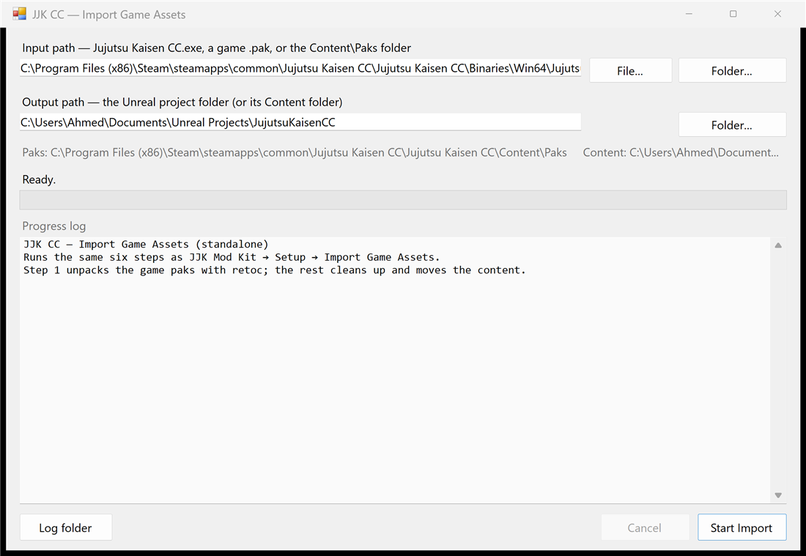

# PAK-Extractor

Unpacks the game files of **Jujutsu Kaisen Cursed Clash** into the
[UE5 Mod Kit](https://github.com/JJKCursedClashModding/UE5-Mod-Kit) project so you can edit them.

It does the same job as **JJK Mod Kit → Setup → Import Game Assets**, but as a separate program —
so the editor doesn't sit frozen for 5–15 minutes while the game's paks are unpacked.



**➜ [Download `JJKCC-Unpacker.exe`](https://github.com/JJKCursedClashModding/PAK-Extractor/releases/download/beta/JJKCC-Unpacker.exe)**
([release page](https://github.com/JJKCursedClashModding/PAK-Extractor/releases/tag/beta)) —
Windows 10/11, nothing to install.

---

## Before you start

* **The game** — installed via Steam. The tool reads its pak files.
* **The [UE5 Mod Kit](https://github.com/JJKCursedClashModding/UE5-Mod-Kit)** — cloned and built
  once, following its README. Do this first: the extractor imports into that project.
* **About 50 GB of free disk space** on the drive that holds the game. It is only used while
  importing, and freed again at the end.
* **Close the Unreal Editor.** The import starts the editor in the background for one of its
  steps, and it can't do that while the editor is already open.

## Use it

1. Run `JJKCC-Unpacker.exe`.
2. Check the two paths — both are filled in for you, usually nothing to change:
   * **Input path** — `Jujutsu Kaisen CC.exe`, normally in
     `C:\Program Files (x86)\Steam\steamapps\common\Jujutsu Kaisen CC\Jujutsu Kaisen CC\Binaries\Win64\`
   * **Output path** — your mod kit folder, the one containing `JujutsuKaisenCC.uproject`
3. Press **Start Import** and confirm with **Yes**.

Then leave it alone for 5–15 minutes. The bar and the log show what it is doing.

### Afterwards, in the editor

1. **Restart the editor** — imported assets only appear in the Content Browser on start-up.
2. Run **JJK Mod Kit → Asset Tools → Stub Character-Capture WBPs** once. The import removes
   three capture widgets that would crash the editor; this puts placeholders back in their place.

You're done — start modding with **JJK Mod Kit → New Mod**. More in the mod kit's README and the
[modding wiki](https://github.com/JJKCursedClashModding/Wiki).

## What the import does

| Step | |
|---|---|
| 1 | Unpacks the game's paks with **retoc** (this is the slow part) |
| 2 | Creates **AnimBlueprint stubs** for every animation blueprint, in the project |
| 3 | Deletes the original animation blueprints, which crash the editor as-is |
| 4 | Deletes the three character-capture widgets, which also crash the editor |
| 5 | Moves everything into the project's `Content` folder |
| 6 | Deletes the temporary files, giving you the disk space back |

## If something goes wrong

| Problem | Fix |
|---|---|
| "Could not find a Content\Paks folder" | The input path is wrong. Point it at `Jujutsu Kaisen CC.exe`. |
| "retoc.exe was not found" | Put `retoc.exe` and `oo2core_9_win64.dll` in the mod kit's `Tools\` folder. Get retoc from its [releases page](https://github.com/trumank/retoc/releases) if you don't have it. |
| retoc fails part-way through | Close the game, then verify the game files in Steam and try again. |
| Step 2 is skipped (animation blueprints missing) | The editor was open, or the mod kit wasn't built yet. Build it, then run **JJK Mod Kit → Asset Tools → Stub ABP From Folder** in the editor. |
| Imported assets don't show up | Restart the editor. |
| Anything else | Press **Log folder** in the window and read the newest log, or ask in the [wiki](https://github.com/JJKCursedClashModding/Wiki). |

---

# Development

### Build from source

```cmd
build.cmd
```

Produces `dist\JJKCC-Unpacker.exe` (a ~120 KB `net48` WinForms binary — Windows ships the
runtime). Needs only the .NET SDK. `tools\make_icon.py` regenerates the icon,
`tools\smoke-test.ps1` runs the same checks as CI.

### Command line

The window is the normal way to use this, but every run is scriptable:

```cmd
JJKCC-Unpacker.exe --cli --input "<game exe or paks>" --output "<project folder>" [options]
```

| Option | |
|---|---|
| `--dry-run` | Resolve everything and print the plan, change nothing |
| `--verify-paks` | Let retoc read the paks without writing anything (checks retoc, the AES key and the install; stops after step 1) |
| `--no-stubs` | Skip the headless-editor AnimBlueprint step |
| `--reuse-data` / `--fresh` | Reuse or discard an existing `Paks\Data` folder |
| `--quiet`, `--help` | |

Exit codes: `0` success, `1` failed, `2` cancelled, `3` finished with warnings.

### Continuous integration

`.github/workflows/build.yml` builds and smoke-tests the exe on `windows-latest`, uploads it as a
workflow artifact, and on every push to `main` updates the **`beta` release** with the new binary
and moves the `beta` tag to that commit. Pushing a `v*` tag creates a normal versioned release.

### How paths and tools are found

* **Paks folder** — from the picked `.exe` (`<exe>\..\..\..\Content\Paks`, then any parent that has
  one), or by walking up from a picked `.pak` / folder.
* **Content folder** — `<project>\Content` when the output folder (or a parent) has a `.uproject`,
  otherwise the output folder itself.
* **retoc** — `%RETOC%`, next to the exe, `<exe>\Tools`, `<project>\Tools`, the paks folder, `PATH`.
* **UnrealEditor-Cmd** — `%UNREAL_EDITOR_CMD%`, the project's JJK Mod Kit setting
  (`UeEditorCmdPath`), `HKLM\SOFTWARE\EpicGames\Unreal Engine\<version>`, then
  `C:\Program Files\Epic Games\UE_5.*`.

If an existing `Paks\Data` folder is found, a dialog offers to reuse it (fast, for a re-run) or to
delete it and unpack from scratch.

### Layout

```
build.cmd                     build -> dist\JJKCC-Unpacker.exe
.github\workflows\build.yml   CI: build, smoke test, beta release
src\JJKCC-Unpacker.csproj     net48 WinForms project
src\Program.cs                entry point, CLI parsing, --diag
src\MainForm.cs               the window: input / output / progress
src\Pipeline.cs               the six steps
src\PathLogic.cs              path + tool discovery (mirrors the project's Python)
src\Fs.cs                     long-path-safe file helpers
src\AppSettings.cs            saved paths + run logs
src\Dpi.cs                    per-monitor DPI helpers
src\app.manifest              DPI awareness, long paths, asInvoker
tools\make_icon.py            icon generator
tools\smoke-test.ps1          smoke test used by CI and locally
```
